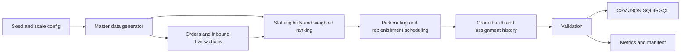
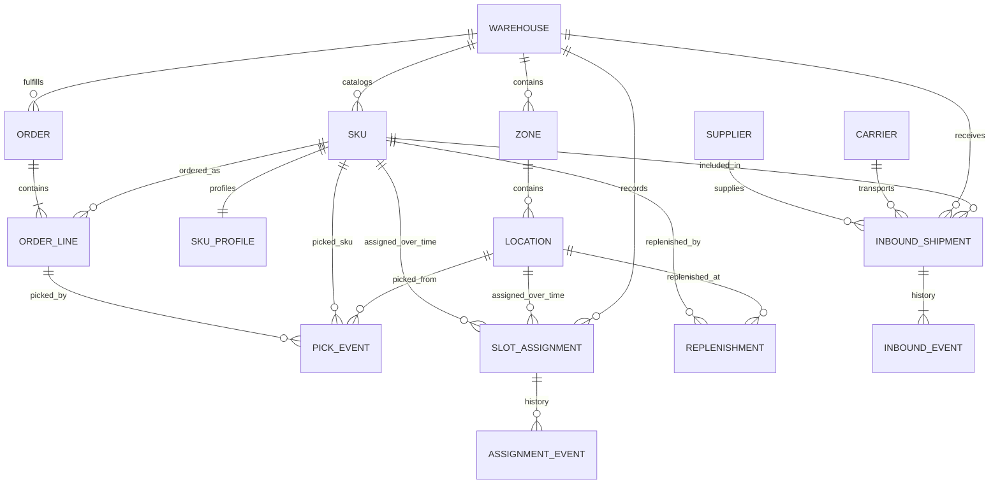

# YottaFlex — Warehouse Slotting Engine

End-to-end, seeded synthetic-data pipeline that places SKUs into warehouse
locations using **demand velocity, dimensions, hazard/temperature compatibility
and replenishment/picking constraints** — then validates, labels anomalies and
reports measurable outcomes.

## How to run

Create and activate a virtual environment first.

**Windows PowerShell**

```powershell
py -m venv .venv
.\.venv\Scripts\Activate.ps1
```

**macOS / Linux**

```bash
python3 -m venv .venv
source .venv/bin/activate
```

Install the project dependency:

```bash
python -m pip install -r requirements.txt
```

Then run the pipeline and checks:

```bash
python -m yottaflex.generate --scale full     --out data           # 20 WH / 10k LOC / 5k SKU / 100k lines
python -m yottaflex.generate --scale starter  --out data_starter    # quick starter set
python -m yottaflex.generate --validate-only --out data            # re-run validations
python -m pytest tests -q                                           # suite
python -c "import json; print(json.dumps(json.load(open('data/metrics.json', encoding='utf-8'))['pick_metrics'], indent=2))"
```

Requires Python 3.10 or later. The generator uses the Python standard library;
`requirements.txt` installs pytest for tests.

## Architecture



## Entity relationships



Fixed seed: **20261022**. The test suite regenerates the starter dataset twice
and compares SHA-256 checksums for every generated output except the timestamped
manifest. The manifest records checksums for generated data files.
## Outputs (`data/`)

| file | rows (full) | contents |
|---|---:|---|
| warehouse.csv | 20 | WH-001 … WH-020 |
| zone.csv | 280 | storage zones, including hazard and temperature compartments |
| location.csv | 10,000 | LOC-<zone>-<seq>, capacity/dimensions/coordinates |
| sku.csv / sku_profile.csv | 5,000 each | hazard, temperature, velocity, ABC class |
| order.csv / order_line.csv | ~25,000 / 100,000 | generated orders and demand lines |
| pick_event.csv | 97,972 | pick records, with 97.97% order-line coverage |
| replenishment.csv | 4,897 | replenishment tasks and derived labor estimates |
| replenishment_event.csv | 14,479 | requested, deferred, and rescheduled replenishment task events |
| slot_assignment.csv | 5,085 | regular assignments, moves, and labelled exceptions |
| assignment_event.csv | 5,205 | assignment activation, deactivation, retirement, reassignment, and exception history |
| supplier.csv / carrier.csv | 40 / 20 | synthetic supplier and carrier masters |
| inbound_shipment.csv | 1,000 | warehouse, supplier, carrier, SKU, and quantity records |
| inbound_event.csv | 2,599 | ordered shipment lifecycle events |
| ground_truth.csv | 32,716 | labelled anomalies, separate from generator input features |
| seed.sql | — | SQLite schema and records |
| manifest.json / metrics.json | — | row counts, checksums, provenance, validation, and metrics |
## Measured results (full scale)

- **Pick-distance baseline vs optimized:** 6,600,530 m → 5,850,081 m = **11.37% savings**
  over the same comparable pick lines, using nearest-neighbor tours and Dijkstra
  routes through the warehouse aisle graph.
- **Slotting coverage:** 4,897 of 5,000 SKUs assigned (97.94%). The 103
  unassigned SKUs have no eligible location after physical fit, capacity,
  compatibility, and operational availability checks.
- **Throughput and replenishment:** 97,972 pick events across 25,000 orders; estimated
  throughput is 23.40 picks per labor hour. All 4,897 replenishment tasks (164,215.88
  labor minutes) are assigned to shifts capped at 480 minutes per warehouse/date/shift.
  Of that workload, 154,673.02 minutes were delayed from the requested shift across
  4,791 tasks. FAST, MEDIUM, then SLOW priority controls allocation; event history
  records requests, deferrals, and reschedules.
- **Capacity utilization:** valid assigned bins use 11.54% of their available
  volume and 10.10% of their available weight capacity.
- **Peak demand coverage:** orders are weighted toward a documented synthetic
  peak period, which is exposed on each order and reflected in shift assignment.
- **Throughput:** metrics report picks per estimated labor hour using an explicit
  1.5 handling minutes per pick plus travel time at 60 m/minute. This is a
  synthetic comparison assumption, not an observed labor standard.
- **Capacity and exceptions:** metrics include volume/weight utilization within
  valid assigned bins, replenishment labor by warehouse and shift, and exception
  counts by type, severity, and resolution status.
- **Inbound:** 1,000 synthetic shipments link suppliers, carriers, warehouses,
  and SKUs. Each shipment has timestamped status history; event sequences are
  checked against the shipment's final state.
- **Validation:** PK uniqueness, FK integrity, enums, date ordering,
  30-day pick-frequency reconciliation, physical compatibility, explicit exception
  labels, ≤1 ACTIVE slot per location outside labelled anomalies — all green.

## Labelled edge cases (`ground_truth.csv`)

`CAPACITY_EXCEEDED`, `INCOMPATIBLE_COLOCATION`, `DUPLICATE_ACTIVE_SLOT`,
`BLOCKED_AISLE_PICK`, `REPLEN_LABOR_EXCEEDED` — each with expected decision +
severity. Anomalies are flagged on dedicated records; unrelated rows are never
silently corrupted, and labels are excluded from generator inputs.

## Design notes

- **Dependency order:** warehouses → zones → locations → SKUs → SKU profile IDs
  → orders/lines → demand-derived profiles → slots → picks → replenishments.
  Every child references a valid parent ID; derived values (ABC class, pick frequency, labor minutes,
  travel distance) are computed from source records, not generated independently.
- **Actor coverage:** suppliers and carriers are represented as synthetic master
  records, with inbound shipments and append-only booked, in-transit, and
  received events. Planners create slot decisions; warehouse operators execute
  picks and replenishment; analysts and operations managers use the metrics and
  exception outputs.
- **Traceable decisions:** assignments carry stable IDs, decisions, status, and
  effective dates; rejected and duplicate exception records are retained.
- **Slot ranking:** eligibility is a hard gate (dimensions under allowed
  orientation, weight/volume, hazard, temperature, and operational availability).
  Eligible candidates receive a documented 0–100 weighted score: velocity 30%,
  dock distance 25%, capacity utilization 15%, replenishment efficiency 15%,
  and preferred-zone operational fit 15%. Starting weights live in
  `yottaflex/config.py` and can be adjusted there.
  Velocity component scores are FAST 100, MEDIUM 65, and SLOW 35. Distance is
  normalized against the maximum dock distance in the layout. Capacity is the
  SKU unit-volume/location-volume ratio, capped at 100. Replenishment score
  follows distance for FAST movers and uses 60% of distance plus 40 for other
  movers. Preferred zones score 100; other otherwise-eligible zones score 40.
- **Blocked-aisle response:** locations are aisle-graph nodes, with within-aisle,
  cross-aisle, zone-transfer, and dock connections. Dijkstra finds routes that
  exclude blocked aisle nodes from transit; blocked locations remain pick endpoints.
  Coordinates and transfer costs define a synthetic graph, not a surveyed facility map.
- **Lawful provenance:** 100% synthetic, no external data. Schema conventions
  inspired by standard WMS practice only.

Velocity is derived from SKU quantity demand in the rolling 30-day window ending
on the latest generated ship date. ABC classes rank nonzero-demand SKUs: A is
the top 20%, B is the next 30%, and C is the remainder. New/zero-demand SKUs are
assigned C.

## Repo layout

```
yottaflex/          generator package (master, transactions, slotting,
                    anomalies, validation, sql_export, generate CLI)
tests/              pytest suite (PK/FK, IDs, reconciliation, labels, reproducibility)
schema/             data dictionary (types, constraints, cardinality, lifecycle)
data/               full-scale output + seed.sql + manifest + metrics
data_starter/       starter-scale output
```
